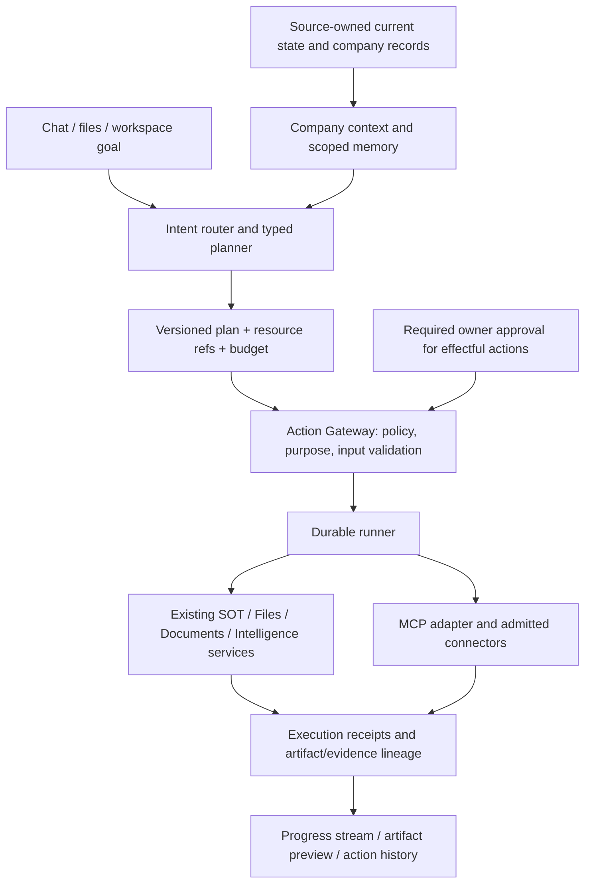

# Blueprint · RtR Enterprise Knowledge & Action OS

Date: 2026-10-06 · revision: 1 · status: **APPROVED FOR LOCAL IMPLEMENTATION**.
Application baseline: `0e88f48588dc3228f1ae9eca7a7597d96589af8b`.

Approval: Homeowner replied `approved` after reviewing the TIP-054 packet on
2026-10-06. This authorizes the local sequence and synthetic tests below;
internal-data external calls, actual connector effects and production remain
outside this approval. Implementation starts with TIP-054.1.

## Outcome and first vertical slice

Employees can state an ordinary goal, receive a useful evidence-based answer,
produce a high-quality file and continue authorized work with reliable progress
and receipts. The operating interface combines knowledge and actions while
each source business application remains authoritative for its transactions.

First vertical slice: an employee asks for an internal project/product brief;
the system resolves the goal, retrieves permitted current material, fills or
composes a supported draft, shows its preview and saves it in Files. A worker
restart continues the work; double submission returns the same artifact; a
revoked permission prevents further disclosure. An official/legal issuance
continues to use the existing reviewer and checksum-bound lifecycle.

## Architecture



The planner recommends steps; the gateway checks the authorized capability;
the executor records work and results. The same service methods and source
rights apply whether a request originates in UI, MCP, a scheduled workflow or
an API. No model-generated SQL or ad hoc tool invocation becomes authority.

Existing ingestion/reindex queues remain owned by their current pipelines.
New workflow execution uses one durable owner after the runtime bake-off.
Document recovery can be repaired independently before integration.

## Company context and governed memory

“Understand the whole company” is expressed as coverage and freshness of
business domains, not a promise that a model contains every fact. The context
service maintains canonical IDs and relations for company/legal entity,
department, people roles, projects, customers, products/configurations,
capabilities, operations, policies, decisions and source systems. A relation
has an owner/source, revision and validity period; absence is visible.

Start with PostgreSQL relation tables plus JSONB payloads. Reuse current SOT
and file indexes; do not add Neo4j or a second fact store before a measured
need. The application is currently single-company; source keys and workspace
scopes prevent identity collisions, while a multi-tenant platform is separate
future scope.

| Context class | Authority | Read/use rule | Update rule |
|---|---|---|---|
| Canonical company facts | Existing SOT revision and owner | Current rights + purpose/use-class | Existing validation/publish gate |
| Live operating state | Source CRM/MRP/IP/HRM API | Source row/field scope, `as_of`, freshness | Source-owned transaction API |
| Research | External source snapshot and tier | Separately labelled evidence | Research admission; no automatic SOT promotion |
| Workspace/task memory | User/team owner with source references | Scope, expiry, deletion and current ACL | Explicit user/owner update; generated inference labelled |
| Model inference/proposal | The current run | Presented as proposed interpretation | User review; never silently canonicalized |

A `ContextPacket` identifies caller/workspace/purpose, selected immutable
resource references, retrieval time, source validity, permitted derived notes
and token/byte budgets. It contains only what the task needs. Cached packets
are keyed by source revision, scope/purpose and authorization version, and are
revalidated before reuse. A revoked source also invalidates memory-derived
disclosure. Preferences cannot authorize new actions or override policy.

Useful partial answers are normal: show supported portions, uncertainty,
stale-state warnings and the smallest follow-up needed. A request for a full
catalog must not be labelled complete without catalog coverage. A failure to
reach one source should not discard other useful authorized work.

## Action contract

An admitted `CapabilitySpec` includes:

- `capability_id`, stable version and schema digest; names describe specific
  operations such as `documents.create_draft` or `crm.read_deal`.
- JSON input/output schemas with bounded fields and allowed resource/recipient
  references; additional properties forbidden unless explicitly modelled.
- Effect class R0–R3, existing policy-action mapping, scope/purpose, allowed
  output destinations and applicable data-export rules.
- Preview support, idempotency/reconciliation strategy and a declared
  compensation capability or explicit irreversible-effect statement.
- Tool/timeout/retry/concurrency limits, accounting fields and source health.
- Implementation reference: internal service or admitted MCP server/tool,
  without tokens or executable code supplied by a model.

`ActionPlan` freezes actor/workspace, objective, ordered/DAG steps, capability
versions, argument hashes, evidence/resource versions, dependencies, effects,
budgets and expected outcomes. `plan_digest` is computed from canonical JSON.
Input changes create a new plan version; previously approved scope cannot be
stretched by a later model turn.

| Class | Examples | User experience |
|---|---|---|
| R0 | Read approved SOT/files/source state | Runs under existing permissions without a confirmation per read |
| R1 | Requested internal draft/report/private task proposal | Explicit creation request authorizes the bounded draft; preview and cancel available |
| R2 | Update a source-owned task/deal/operational record | Show exact change/affected record; execute after matching authorization/confirmation |
| R3 | Send externally, issue official document, financial/legal approval | Apply configured owner/reviewer decision and existing separation of duties |

A pro-active R1 proposal can be prepared, but unsolicited publication or
delivery is a different effect. MCP annotations are hints; the host capability
registry establishes the actual minimum effect class. Approval binds digest,
tool/resource versions, destinations, relevant amount/limits, actor/reviewer
and expiry. Rights, data-export policy and source state are checked again at
execution/resumption, even if the plan was previously approved.

## Durable execution and receipts

Domain state is explicit:

```text
planned → ready / awaiting_input / awaiting_approval
ready → queued → running → succeeded / partial / failed / cancelled
running → reconciling → succeeded / partial / needs_review
```

Events and step attempts preserve chronology. `cancelled` means remaining work
stopped; it never implies an already-sent message or committed transaction
was undone. Compensation is a separate authorized operation with its own
receipt. A workflow can return a useful partial artifact with specific failed
steps and a safe continuation.

Proposed domain tables: `capability_versions`, `action_plans`, `action_runs`,
`action_step_attempts`, `action_approvals`, `action_receipts`,
`action_events`, `memory_entries`, `context_packets`, `connector_admissions`
and later `workflow_subscriptions`. Derive exact migrations from TIP contracts
and reuse existing resources/audit/approval references. Durable-engine state
lives in its own schema/database; it is not the business receipt ledger.

Receipt includes run/step/attempt, source operation/idempotency key, outcome,
source object/version, input/output digests, artifact or evidence refs,
timestamps and request/build correlation. Sensitive payloads reside in
authorized resources, not ordinary logs.

Effect execution protocol:

1. Persist intent and current authorization; atomically mark the attempt ready.
2. Claim through the runner with lease/ownership fencing where needed.
3. Revalidate rights, approval binding and capability/resource versions.
4. Call the source using its idempotency key or transactional mechanism.
5. Verify the source result and persist the receipt/outcome.
6. If a crash/timeout occurs after a possible effect, reconcile by source key
   or operation-status API. An unsupported ambiguous effect becomes
   `needs_review`; do not blindly retry it.

There is no universal exactly-once guarantee across unrelated external APIs.
Guarantees are declared per adapter and demonstrated with fault injection.
Durable workflow checkpointing does not remove the step-4/step-5 uncertainty.

## MCP integration

Two directions are separate capabilities:

- Outbound MCP client: Copilot accesses admitted source tools on behalf of the
  caller. Initial release supports bounded read-only tools and synthetic
  contract servers; real credentials/endpoints are source-owner configured.
- Optional inbound MCP server: expose selected existing read/search/draft
  capabilities to approved internal clients, with the same subject/policy
  checks. Deployment and broad discovery remain disabled until certified.

Pin protocol/SDK versions after compatibility tests. The researched spec
revision is 2026-07-28; this is not evidence that every source server or SDK
supports that revision. Negotiate supported features and refuse unsupported
protected operations rather than silently changing authentication behavior.

Admission freezes endpoint, owner, authenticated issuer/resource audience,
allowed tool/schema hashes, permitted scopes/destinations, data classifications,
limits and health. Discovery changes quarantine affected tools until reviewed.
Tokens remain server-side and destination-bound. Content returned by a source
is data, including embedded instructions; it cannot modify system policy or
turn a read into an authorized write. Enforce redirect/SSRF/egress rules in
network adapters, not only in prompts.

Use an MCP library adapter behind our contracts rather than inventing the
JSON-RPC/auth implementation. Native REST adapters remain valid for source
applications; MCP is not mandatory for every useful integration.

## Artifact experience and quality

Reuse the existing compact shell, fixed composer, transcript and evidence
rail. A requested task shows a concise editable scope, real running stages,
sources, drafts and final receipts. The right rail can show Sources, Files and
Actions; avoid exposing framework/queue jargon to employees. Questions need
clarification only when an ambiguity materially changes the result/effect.

Support two composition paths: approved templates for stable/official formats;
structured flexible drafts for everyday internal work. Draft content uses a
typed intermediate representation (sections/tables/chart specifications and
references), then deterministic renderers. Code/formula execution belongs in
an isolated renderer with explicit resource/network limits.

Acceptance checks include Vietnamese glyph coverage, untruncated content,
meaningful headings/spacing, tables that fit, page/slide overflow, formula
recalculation and cached results, no invented specifications, and consistent
source references. Text, office and rendered visual inspections complement
one another. Each supported format is certified independently; extension
support alone is insufficient.

## Cost and latency policy

These are proposed acceptance targets, not measured current achievements:

| Measurement | Proposed local/pilot gate |
|---|---|
| UI acknowledges submission / cancellation | p95 ≤ 1 s under declared pilot load |
| Pure local policy/schema/plan path | p95 ≤ 500 ms, with no provider call |
| First authorized source/checkpoint | p95 ≤ 3 s when source dependencies are healthy |
| Ordinary grounded answer | p95 ≤ 25 s; p99 ≤ 45 s on approved provider/case profile |
| Medium draft file available for preview | p95 ≤ 90 s on declared fixture/renderer profile |
| Extra orchestration overhead vs matched direct operation | p95 ≤ 1 s in runtime bake-off |
| Known-effect duplicate count / unauthorized disclosure | 0 in the finite adversarial suite |
| Everyday workflow first-attempt success | ≥ 95% on frozen stratified evaluation |
| Three-trial stable success | ≥ 90%, all trials retained; no cherry-pick |

Measure end-to-end time, provider time and local overhead separately. Long
operations show real progress and can run in background. Provider failure
preserves drafts/checkpoints and offers a bounded next step; UI animation
never implies sources/results that do not exist.

Deterministic lookup/validation/rendering bypass LLM. Complex tasks normally
use one typed planning call and one composition call, with at most one bounded
repair when validation shows a specific problem. Model calls, tool calls,
input/output tokens, wall time and money are charged to the same run. Any
agent fan-out consumes the parent budget. No automatic judge loop on every
ordinary response.

Budgets are configuration, not invented prices: use current verified rates
and actual provider usage; mark monetary estimates as unpriced when missing.
No live campaign executes with an unpriced/unbounded budget. Compare **cost
per accepted business outcome**, not only token cost. Cache only within valid
source/identity/purpose boundaries. Reuse frozen captures instead of recrawling
on every planning iteration.

## Evaluation and promotion

The checked-in synthetic catalog is the initial design dataset. It is not
human testing and contains no real transaction authority. Execute relevant
subsets as modules are built; the integrated release then runs the full
catalog against the exact serving candidate.

Use deterministic state/receipt/file/schema/policy oracles for correctness.
Evaluate language usefulness against a frozen fact/task oracle, with blinded
holdouts and repeated trials. An LLM judge is advisory; it cannot fabricate
employee observations or waive state-integrity failures. A build change
invalidates affected certification only; unchanged evidence can be retained
with a documented dependency link instead of re-running every paid campaign.

Source event/delete/ACL tests, worker crashes, duplicate dispatch, approval
expiry/input changes, dangerous instructions in file/tool content, malformed
schemas, unknown effects and partial recovery are mandatory action tests.
On local 10/25/50 concurrency profiles, record machine resources, corpus/tool
sizes, queue depth, database contention and p50/p95/p99 with raw trials. Scale
claims require measured larger profiles.

## Contract and approval boundary

Approve this Blueprint to authorize the local sequence 054.1–054.9, including
public dependency investigation and synthetic bake-offs, with a report after
each milestone. The runtime choice may switch between DBOS and Temporal under
the documented selection gate while preserving the same application contract;
the chosen adapter and evidence are recorded before integration.

External calls carrying internal evidence, actual business-system write
permissions, production connectors and deployment are separately governed by
their existing authorization boundaries. No additional approval is needed for
routine local implementation/tests within this contract.

Checklist: architecture fit; business usefulness; low-friction reads/drafts;
source and memory integrity; recoverable execution; measurable latency/cost;
staged implementation; actionable acceptance oracles.
